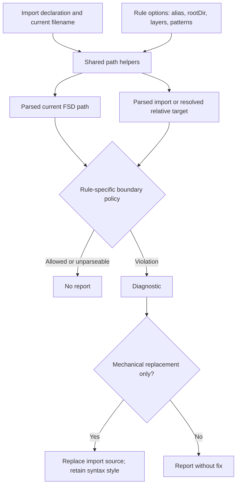

# FSD Import Plugin Roadmap - Plan

## Goal Capsule

- **Objective:** Turn the roadmap into a lightweight, portable ESLint plugin with shared FSD path parsing, focused rules, predictable safe autofixes, recommended configurations, and complete rule documentation.
- **Authority:** `ROADMAP.md` defines product scope; current source and tests define compatibility patterns; official ESLint documentation defines plugin and rule-metadata contracts.
- **Execution profile:** Make changes in dependency order and preserve existing behavior unless a roadmap stage changes it. `recommended` contains every exported rule except `public-api-imports`, which remains opt-in because its test-file and layer exceptions are project-specific.
- **Stop conditions:** Do not introduce runtime dependencies, filesystem existence checks, or an unapproved public-API break. Do not publish `slice-boundaries` in `recommended` before its design-note decision and compatibility coverage are complete.
- **Tail ownership:** Implementation owns code, tests, documentation, package metadata, and release evidence.

---

## Product Contract

### Summary

The plugin will share one root-aware FSD path model across its rules, then add narrowly scoped import-boundary rules on top of that model.
The public package will expose explicit rules and both legacy and flat recommended configurations after the rule set is complete.

### Problem Frame

Current rules duplicate path parsing and rely on `split("src")`, which misreads custom roots and path segments that merely contain `src`.
Alias removal can change strings that only resemble an alias, and existing fixers rewrite quote style.
The plugin has no single documented configuration surface for ESLint legacy and flat configs, so adoption and future rule expansion are harder than necessary.

### Requirements

#### Path foundation and existing behavior

- R1. Normalize Unix and Windows paths, remove aliases only at import-path boundaries, and parse FSD layer and slice information relative to a configurable `rootDir` that defaults to `src`.
- R2. Migrate existing rules to the shared path helpers without changing their default behavior, and make unparseable paths a quiet no-op.
- R3. Validate every rule option strictly, including unknown object keys and non-string entries in pattern arrays, while retaining documented defaults and compatibility with the supported ESLint peer range.
- R4. Preserve source quote style in existing autofixes and leave type-only import syntax untouched apart from its module specifier.

#### Rule set

- R5. Add `no-cross-slice-relative-imports` to prevent relative imports between slices in configured slice-based layers without guessing an autofix.
- R6. Add `shared-public-api-imports` to prevent deep imports below configured `shared` segments, support alias and `rootDir` normalization, and autofix only the mechanical public-segment case.
- R7. Add `forbidden-app-imports` with alias-aware allow and test-file exceptions.
- R8. Add `no-deprecated-layer-names` to report mapped legacy layer names and rewrite only the import module specifier.
- R9. Design and add `slice-boundaries` as a non-fixing rule that handles absolute, alias, and relative cross-slice imports without duplicate reports from overlapping rules.

#### Packaging, documentation, and verification

- R10. Remove `requireindex`, export all rules explicitly, and provide legacy `recommended` plus flat `flat/recommended` configurations. Both presets enable every exported rule except `public-api-imports`.
- R11. Document every rule, its options, examples, and autofix behavior; document that `public-api-imports` remains opt-in and why.
- R12. Cover path variants, configuration validation, fixes, exports, documentation links, dependency footprint, and the published ESLint compatibility promise through automated checks or a reproducible release matrix.

### Acceptance Examples

- AE1. Given an alias of `@`, `@/entities/User` is parsed as `entities/User`, while `some-@/entities/User` and `@app/entities/User` remain unchanged.
- AE2. Given a Windows or Unix filename under a custom root, the same layer and slice are identified without matching `src` inside a parent-directory name.
- AE3. Given a relative import from `entities/Article` to `entities/User`, the cross-slice rule reports it; a relative import that remains in `entities/Article` does not report.
- AE4. Given a deep `shared/ui` import after alias or configured-`rootDir` normalization, the shared public-API rule reports it and fixes only the import source when the target is mechanically reducible to the segment public API.
- AE5. Given `import type` and either quote style, an existing fixer changes only the module specifier and retains the original quote delimiter.
- AE6. Given the installed package, both configuration formats enable every exported rule except `public-api-imports`, and the flat configuration embeds the same exported plugin object under `fsd-import`.

### Scope Boundaries

- **In scope:** All eleven roadmap stages, including the `slice-boundaries` design note, rule implementation, documentation, and release hygiene.
- **Out of scope:** Filesystem probing for `index.ts`, automatic migration of files on disk, changing project source-code imports, or enabling `public-api-imports` in `recommended` by default.

#### Deferred to Follow-Up Work

- Gather feedback from real projects before reconsidering whether `public-api-imports` should join `recommended`.
- Consider a major release only if a future behavior change cannot preserve the current default configuration contract.

---

## Planning Contract

### Key Technical Decisions

- KTD1. **Use one pure, root-aware path contract.** Helpers normalize separators before parsing, match `rootDir` as a complete path segment, and return `null` when a path lacks an FSD layer or slice. This replaces ad hoc string splitting and lets rules safely opt out when context is not an FSD source file.
- KTD2. **Resolve relative imports with platform-aware path semantics.** The relative-import rules must resolve against the importing file using Windows semantics for Windows-form paths and POSIX semantics otherwise, then parse the normalized target. This keeps test fixtures portable and avoids host-platform-dependent results.
- KTD3. **Keep linting lightweight and fixes conservative.** Rules inspect the AST and configured strings only. A fixer may replace the source literal only when the canonical target follows from the import path; it never scans the filesystem or invents a public API.
- KTD4. **Make schemas strict but preserve runtime defaults manually.** Every option object disallows unknown properties and validates array item types. Rule implementations continue to supply safe defaults so behavior does not depend solely on newer ESLint metadata while the package supports ESLint 7+.
- KTD5. **Export configurations from the plugin object after it is assembled.** CommonJS exports an object containing `rules` and `configs`; the flat preset directly embeds that same plugin object while the legacy preset uses the plugin name string. Export shape must match the README consumption example and be exercised under both supported configuration models.
- KTD6. **Keep rule responsibilities separate.** Specialized rules provide focused diagnostics first. `slice-boundaries` is designed against their overlap before implementation, then enters `recommended` with a decision table that prevents duplicate reports.

### High-Level Technical Design

The helper contract feeds every rule; rule policies remain independent so diagnostics do not share hidden behavior.
Only a deterministic module-specifier replacement may reach the fixer path.

### Sequencing

Build and characterize the path foundation before migrating rules or adding rules that depend on it.
Finish explicit exports and strict metadata before publishing configurations, then complete documentation and release checks against the final exported rule set.

### Assumptions

- `rootDir: "src"` remains the default and current valid/invalid cases remain valid unless a roadmap requirement deliberately changes them.
- The package continues to advertise an ESLint peer range of `>=7`; implementation verifies the practical matrix and treats any Node-engine conflict as a release decision rather than silently changing it.
- Existing `micromatch` remains the pattern engine for configured allow and ignore lists; no new runtime package is needed.

### Sources & Research

- `ROADMAP.md` supplies the ordered scope and behavior constraints.
- `STAGE_1_PLAN.md` provides the already-recorded path-helper and regression-test expectations for the foundation work.
- `lib/helpers/helpers.js`, `lib/rules/*.js`, and `tests/lib/rules/*.js` show the current CommonJS, RuleTester, fixer, and path-parsing patterns that the plan replaces or extends.
- [ESLint custom-rule documentation](https://github.com/eslint/eslint/blob/v10.5.0/docs/src/extend/custom-rules.md) supports strict `meta.schema` and `meta.defaultOptions`; its v8.57.1 documentation confirms the positional schema form required for older ESLint compatibility.
- [ESLint plugin documentation](https://github.com/eslint/eslint/blob/v10.5.0/docs/src/extend/plugins.md) defines dual exports for legacy configs and flat configs that reference the plugin object directly.

---

## Implementation Units

| Unit | Scope | Depends on |
| --- | --- | --- |
| U1 | Shared path contract and helper coverage | None |
| U2 | Existing rule migration and root-aware docs | U1 |
| U3 | Cross-slice relative-import rule | U1, U2 |
| U4 | Explicit rule exports and dependency removal | U3 |
| U5 | Strict schemas and compatibility validation | U2, U3, U4 |
| U6 | Quote-preserving existing autofixes | U2 |
| U7 | Shared public-API rule | U1, U5 |
| U8 | Forbidden app-import rule | U1, U5 |
| U9 | Deprecated layer-name rule | U1, U5 |
| U10 | Slice-boundaries design and boundary rule | U3, U7, U9 |
| U11 | Recommended configs, documentation, and release hygiene | U3–U10, U4 |

### U1. Establish the shared FSD path contract

- **Goal:** Replace fragile path string manipulation with tested normalization, alias stripping, root extraction, FSD parsing, filename parsing, and relative-target resolution helpers.
- **Requirements:** R1, R12; Covers AE1 and AE2.
- **Dependencies:** None.
- **Files:** `lib/helpers/helpers.js`, `tests/lib/helpers/helpers.js`.
- **Approach:** Define a small pure-helper surface that returns normalized values or `null`, never logs, and distinguishes a whole alias or root segment from a lookalike substring. Centralize native-path selection for Windows-form and POSIX-form fixture paths.
- **Patterns to follow:** CommonJS exports in `lib/helpers/helpers.js`; Mocha plus Node `assert` for helper-focused tests.
- **Test scenarios:**
  - Alias removal accepts only an exact leading alias segment and leaves lookalikes unchanged.
  - Windows and Unix filenames under `src` parse to the same layer, slice, and remaining segments.
  - A custom `rootDir` parses correctly, while a parent name containing `src` does not become a false root.
  - Missing roots, non-FSD locations, relative-only values, and incomplete layer paths return `null` without throwing.
  - Relative target resolution identifies the same target semantics for Windows-form and POSIX-form paths.
- **Verification:** Existing rules can consume the helper results without host-specific parsing, and every supported edge case has an isolated helper assertion.

### U2. Migrate existing rules to the shared path model

- **Goal:** Move `fsd-relative-path`, `layer-imports`, and `public-api-imports` to shared parsing and expose `rootDir` consistently without changing their default outcomes.
- **Requirements:** R1, R2, R12; Covers AE1 and AE2.
- **Dependencies:** U1.
- **Files:** `lib/rules/fsd-relative-path.js`, `lib/rules/layer-imports.js`, `lib/rules/public-api-imports.js`, `tests/lib/rules/fsd-relative-path.js`, `tests/lib/rules/layer-imports.js`, `tests/lib/rules/public-api-imports.js`, `docs/rules/fsd-relative-path.md`, `docs/rules/layer-imports.md`, `docs/rules/public-api-imports.md`.
- **Approach:** Replace local alias and `src` splitting with the helper contract. Pass `rootDir` through rules that need filename parsing, preserve each rule's layer policy, and return normally when either side cannot be parsed.
- **Patterns to follow:** Existing RuleTester valid/invalid fixture structure and documented option sections.
- **Test scenarios:**
  - Existing default valid and invalid cases retain their diagnostic and fix behavior.
  - Windows and Unix filenames work for all filename-aware rules.
  - Custom roots and alias lookalikes neither produce false positives nor bypass applicable validation.
  - Unparseable filenames and imports do not emit diagnostics or write to console output.
- **Verification:** No rule retains direct `split("src")` or unsafe alias replacement, and the documented default configuration remains behaviorally compatible.

### U3. Add no-cross-slice-relative-imports

- **Goal:** Detect relative imports that cross slices inside configured slice-based layers without offering an unsafe public-API fix.
- **Requirements:** R5, R12; Covers AE3.
- **Dependencies:** U1, U2.
- **Files:** `lib/rules/no-cross-slice-relative-imports.js`, `tests/lib/rules/no-cross-slice-relative-imports.js`, `docs/rules/no-cross-slice-relative-imports.md`.
- **Approach:** Ignore non-relative imports, resolve a relative source from the importing filename through U1, parse both sides, and report only when layer matches and slice differs within configured layers. Apply ignore patterns before reporting.
- **Patterns to follow:** `isPathRelative`, `micromatch` ignore behavior, and RuleTester fixtures from existing rules.
- **Test scenarios:**
  - A same-slice relative import remains valid.
  - Entity-to-entity and feature-to-feature relative imports across distinct slices report.
  - Shared structure, npm imports, absolute public-API imports, ignored imports, and paths outside configured layers remain valid.
  - Windows and Unix forms produce identical report decisions.
  - An unresolved or unparseable relative target does not report and never proposes a fix.
- **Verification:** The rule detects the intended bypass of public APIs without filesystem access or false reports outside slice-based layers.

### U4. Replace requireindex with explicit package exports

- **Goal:** Make the public rule registry transparent and remove the `requireindex` runtime dependency.
- **Requirements:** R10, R12.
- **Dependencies:** U3.
- **Files:** `lib/index.js`, `package.json`, `package-lock.json`, `tests/lib/index.js`, `README.md`.
- **Approach:** Define the package export as one CommonJS plugin object, explicitly enumerate every rule shipped through U3 (including `no-cross-slice-relative-imports`), and leave space for configurations to reference that same object in U11. Remove the dependency and describe the contributor obligation to register future rules.
- **Execution note:** Prefer install and runtime smoke verification over unit-only proof because this changes package loading and dependency metadata.
- **Patterns to follow:** Current CommonJS package entry in `package.json` and direct rule-module imports used by tests.
- **Test scenarios:**
  - Requiring the package exposes every currently shipped rule by name.
  - The installed dependency tree no longer needs `requireindex` as a direct runtime dependency.
  - Adding the explicit registry does not alter the package main or exports entry points.
- **Verification:** A consumer can require the package and find the expected rules without directory auto-loading.

### U5. Tighten option schemas and test the compatibility contract

- **Goal:** Reject misspelled and wrongly typed options for every rule shipped through U5, establish the reusable schema-validation contract required by later rules, and preserve valid configurations across the supported ESLint range.
- **Requirements:** R3, R12.
- **Dependencies:** U2, U3, U4.
- **Files:** `lib/rules/fsd-relative-path.js`, `lib/rules/layer-imports.js`, `lib/rules/public-api-imports.js`, `lib/rules/no-cross-slice-relative-imports.js`, `tests/lib/rule-options.js`, `.github/workflows/compatibility.yml`, `package.json`.
- **Approach:** Add `additionalProperties: false` to each options object shipped through U5, constrain all pattern and layer arrays to strings, and align schema defaults with runtime fallbacks. Add reusable configuration-validation coverage and a compatibility matrix that exercises the lowest supported ESLint major and the current development major before release. U7–U10 must apply this contract and add their own option-specific invalid cases when their rules are introduced.
- **Patterns to follow:** Existing `meta.schema` and `defaultOptions` metadata; ESLint's documented array-form schema for older versions.
- **Test scenarios:**
  - Known option objects with empty and populated string arrays validate.
  - Misspelled properties, number entries in pattern arrays, and extra option-array positions fail configuration validation.
  - Omitted options still select the documented defaults.
  - The compatibility matrix loads each exported rule and one representative legacy and flat configuration under the declared ESLint peer-range endpoints.
  - The matrix runs only Node versions that satisfy each selected ESLint major; a mismatch becomes an explicit engine-policy decision rather than a skipped check.
- **Verification:** Invalid configurations for every rule shipped through U5 fail before rule execution, current user configurations keep working, and the tested peer and Node boundaries are recorded for release review. Later rule units extend the same validation suite with their own schemas.

### U6. Make existing autofixes syntax-preserving

- **Goal:** Keep quote delimiters and type-only import form intact when existing rules replace an import module specifier.
- **Requirements:** R4, R12; Covers AE5.
- **Dependencies:** U2.
- **Files:** `lib/rules/fsd-relative-path.js`, `lib/rules/public-api-imports.js`, `tests/lib/rules/fsd-relative-path.js`, `tests/lib/rules/public-api-imports.js`, `docs/rules/fsd-relative-path.md`, `docs/rules/public-api-imports.md`.
- **Approach:** Base replacement on the source-literal range and retain the literal's existing delimiter. Restrict each fixer to the module specifier so `import type` and surrounding declaration syntax remain unchanged.
- **Patterns to follow:** Existing fixer tests that assert full output text.
- **Test scenarios:**
  - Single-quoted and double-quoted deep public imports fix to matching quote style.
  - Single-quoted and double-quoted same-slice absolute imports fix to matching relative style.
  - Type-only imports retain the `type` modifier and only change their source literal.
  - Fix output does not alter imported bindings, comments, or text outside the literal.
- **Verification:** All existing fixes remain functionally correct and produce minimal source diffs.

### U7. Add shared-public-api-imports

- **Goal:** Enforce public imports for configured `shared` segments while avoiding filesystem-dependent assumptions.
- **Requirements:** R3, R6, R12; Covers AE4.
- **Dependencies:** U1, U5.
- **Files:** `lib/rules/shared-public-api-imports.js`, `tests/lib/rules/shared-public-api-imports.js`, `docs/rules/shared-public-api-imports.md`, `lib/index.js`.
- **Approach:** The option contract is `{ alias: "@", rootDir: "src", segments: ["ui", "lib", "api", "config"], ignoreImportPatterns: [] }`. Strip a valid alias, then remove an exact leading `rootDir` segment when present so `src/shared/...` and a custom-root equivalent are interpreted as `shared/...`. Inspect only imports beginning with `shared/<segment>`, apply configured segment and ignore lists, and report paths deeper than the public segment. Fix only a source that can be deterministically reduced to `shared/<segment>`.
- **Patterns to follow:** Public-API diagnostics, `micromatch` ignore options, explicit rule registry from U4.
- **Test scenarios:**
  - `shared/ui` and `shared/lib` imports remain valid.
  - Deep imports under default and custom segments report with expected fixed output.
  - Alias and non-alias forms behave equally.
  - Default and custom `rootDir` prefixes are normalized before `shared/<segment>` matching.
  - npm imports and paths in non-shared layers remain valid.
  - Ignore patterns suppress only matching imports, and non-mechanical paths receive no unsafe fix.
  - Unknown option keys, a non-string `rootDir`, and non-string entries in `segments` or `ignoreImportPatterns` fail configuration validation.
- **Verification:** The rule remains string-based, has no filesystem work, and is exported with complete usage documentation.

### U8. Add forbidden-app-imports

- **Goal:** Give imports from `app` a dedicated, understandable diagnostic with narrowly scoped exceptions.
- **Requirements:** R3, R7, R12.
- **Dependencies:** U1, U5.
- **Files:** `lib/rules/forbidden-app-imports.js`, `tests/lib/rules/forbidden-app-imports.js`, `docs/rules/forbidden-app-imports.md`, `lib/index.js`.
- **Approach:** Parse an alias-aware import path, report the `app` layer, and skip only explicitly matching `allowPatterns` or current-file `testFilesPatterns`. Keep the rule diagnostic-only.
- **Patterns to follow:** `layer-imports` ignore checks and `public-api-imports` test-file glob checks.
- **Test scenarios:**
  - Alias and non-alias imports from `app` report.
  - Non-app imports, npm imports, and unparseable paths stay valid.
  - Matching allow patterns and test-file patterns suppress reports only in their intended dimension.
  - Unknown option keys and malformed `allowPatterns` or `testFilesPatterns` arrays fail this rule's schema validation.
- **Verification:** Consumers can express Storybook, setup, and bootstrap exceptions without weakening all app-boundary checks.

### U9. Add no-deprecated-layer-names

- **Goal:** Help projects migrate import paths from mapped legacy FSD layer names without touching files on disk.
- **Requirements:** R3, R8, R12.
- **Dependencies:** U1, U5, U6.
- **Files:** `lib/rules/no-deprecated-layer-names.js`, `tests/lib/rules/no-deprecated-layer-names.js`, `docs/rules/no-deprecated-layer-names.md`, `lib/index.js`.
- **Approach:** The migration map option is named `layersMap` and is an object whose values are strings. Read the first path segment after an exact alias, consult `layersMap`, report known legacy names, and replace only that segment in the import source.
- **Patterns to follow:** Alias handling from U1 and literal-only fixer discipline from U6.
- **Test scenarios:**
  - Alias and non-alias deprecated layer imports report and fix to their mapped layer.
  - Unknown layers and imports without a matching map remain valid.
  - Only the module specifier changes; bindings, quote style, and filename paths do not.
  - Unknown option keys and non-string `layersMap` values fail schema validation.
- **Verification:** The rule supports import-only migrations with deterministic fixes and no filesystem mutation.

### U10. Design and add slice-boundaries

- **Goal:** Define the overlap policy first, then implement the recommended rule for cross-slice internal imports across path styles.
- **Requirements:** R3, R9, R12.
- **Dependencies:** U3, U7, U9.
- **Files:** `docs/rules/slice-boundaries-design.md`, `lib/rules/slice-boundaries.js`, `tests/lib/rules/slice-boundaries.js`, `tests/lib/rule-overlaps.js`, `docs/rules/slice-boundaries.md`, `lib/index.js`.
- **Approach:** The option contract is `{ alias: "@", rootDir: "src", layers: ["entities", "features", "pages", "widgets"], allowTestingPublicApi: true, testFilesPatterns: [] }`. Record a decision table that distinguishes same-slice, cross-slice, testing public API, absolute, alias, and relative paths. Specify which diagnostic owns each overlap with `public-api-imports` and `no-cross-slice-relative-imports`, then implement the selected behavior without autofix.
- **Technical design:** The design note is authoritative for the cross-rule decision matrix; implementation may refine helper calls but must not widen the documented rule scope without revisiting that note.
- **Patterns to follow:** U3 relative-target parsing, U7 public-API boundaries, and existing rule-option documentation.
- **Test scenarios:**
  - Absolute, alias, and relative internal imports crossing configured slices report according to the design note.
  - Same-slice imports and allowed testing public APIs remain valid.
  - A combined-rule configuration produces only the designated diagnostic when another specialized rule applies.
  - Custom roots, aliases, test patterns, and Windows/Unix forms preserve the decision matrix.
  - The rule produces no autofix output.
  - Unknown option keys, non-string layer and test-pattern entries, and a non-boolean `allowTestingPublicApi` fail schema validation.
- **Verification:** The design note and tests make each rule-overlap decision visible, and U11 can safely include the rule in `recommended`.

### U11. Publish recommended configs and complete documentation hygiene

- **Goal:** Deliver a discoverable final package surface, explain rule-selection posture, and establish release evidence.
- **Requirements:** R10, R11, R12; Covers AE6.
- **Dependencies:** U3–U10, U4.
- **Files:** `lib/index.js`, `tests/lib/index.js`, `README.md`, `CHANGELOG.md`, `docs/rules/fsd-relative-path.md`, `docs/rules/layer-imports.md`, `docs/rules/public-api-imports.md`, `docs/rules/no-cross-slice-relative-imports.md`, `docs/rules/shared-public-api-imports.md`, `docs/rules/forbidden-app-imports.md`, `docs/rules/no-deprecated-layer-names.md`, `docs/rules/slice-boundaries.md`.
- **Approach:** Export legacy `recommended` and `flat/recommended` configs from the assembled plugin object. Both presets enable every exported rule except `public-api-imports`; it remains opt-in because its test-file and layer exceptions are project-specific. Document that selection and the rationale. Update the README for both config styles, `alias`, and `rootDir`, add an initial release-notes entry in `CHANGELOG.md`, then record release-facing dependency and compatibility checks.
- **Patterns to follow:** Explicit plugin object from U4 and ESLint's dual-config export model.
- **Test scenarios:**
  - The plugin export exposes all implemented rules, `configs.recommended`, and `configs["flat/recommended"]`.
  - Legacy config uses the plugin-name array and flat config embeds the same plugin object under `fsd-import`.
  - Legacy and flat recommended configs enable every exported rule except `public-api-imports` and omit no other implemented rule.
  - README examples parse as their claimed config format, and every linked rule document exists.
  - Dependency-footprint checks show no accidental runtime additions.
- **Verification:** A user can install the package, choose legacy or flat config, identify `public-api-imports` as the sole opt-in rule, and follow documentation without reading source code.

---

## System-Wide Impact

- **Public package surface:** Explicit rule registration and `configs` exports become part of the published CommonJS API and must be tested as a consumer would load them.
- **Configuration compatibility:** Stricter schemas turn previously ignored misspellings into configuration errors, so docs and release notes must call out the intentional validation change.
- **Rule interaction:** Shared parsing makes path semantics consistent, but `slice-boundaries` needs explicit overlap ownership to avoid multiple diagnostics for one import.
- **Portability:** Windows fixtures must remain valid when tests run on Unix hosts and vice versa; host-native path behavior cannot decide rule semantics by itself.

---

## Risks & Dependencies

| Risk or dependency | Mitigation |
| --- | --- |
| ESLint 7+ peer promise conflicts with newer metadata or Node requirements | Keep runtime defaults independent of metadata, add a peer-range load matrix, and make any engine-range change an explicit release decision. |
| Flat preset shape drifts from the documented consumer example | Load the README-style legacy and flat configurations in export tests and the compatibility matrix. |
| New strict schemas reject a consumer's typo that was formerly ignored | Document option changes, retain valid defaults, and cover valid plus invalid configuration cases. |
| Multiple boundary rules report the same import | Write and test the `slice-boundaries` decision matrix before implementation, then include the proven rule in `recommended`. |
| Autofixes create invalid or noisy edits | Limit fixes to module-specifier literals, retain quote style, and do not inspect the filesystem. |
| Path tests depend on the host operating system | Centralize platform-aware resolution and use paired Windows/Unix fixtures for every filename-aware rule. |
| Rule expansion introduces accidental package weight | Use Node and ESLint APIs plus existing `micromatch`; inspect runtime dependencies before release. |

---

## Verification Contract

| Gate | Applies to | Done signal |
| --- | --- | --- |
| `npm test` | U1–U11 | Mocha passes helper, rule, export, and configuration tests. |
| `npm run lint` | U1–U11 | Source, tests, docs-adjacent JavaScript, and configuration changes satisfy repository linting. |
| Package-load smoke check | U4, U11 | The CommonJS package entry loads and exposes every intended rule and configuration. |
| Dependency footprint check | U4, U11 | `requireindex` is absent as a direct runtime dependency and no unplanned runtime dependency appears. |
| ESLint compatibility matrix | U5, U11 | The lowest declared peer major and current development major load the plugin and validate representative configurations. |
| Documentation link and example audit | U2, U3, U7–U11 | README and rule-document links resolve, examples match exported configuration shape, and the `public-api-imports` opt-in posture is stated. |

---

## Definition of Done

- U1–U11 meet their listed verification outcomes and test scenarios.
- Default behavior remains backward compatible for existing rules, except where a documented roadmap requirement intentionally changes validation.
- All rule metadata, schemas, docs, exports, recommended configurations, and release-facing evidence agree on rule names and option shapes.
- Every implemented rule is exported and documented; legacy and flat `recommended` configs include each one except `public-api-imports`.
- No filesystem checks or new runtime dependencies were added for rule enforcement.
- The final diff contains no abandoned helper, fixer, or configuration experiments.
